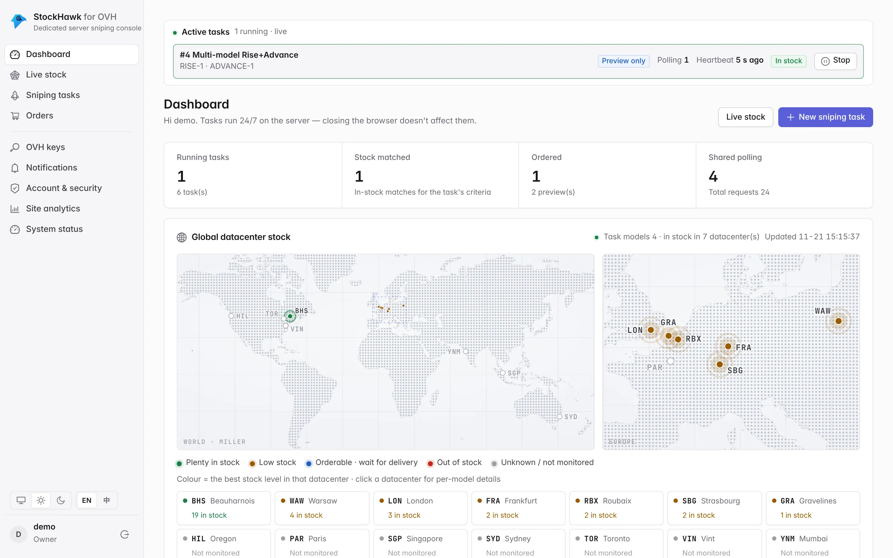
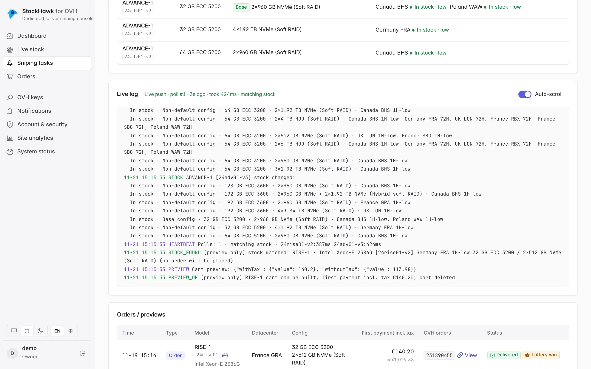
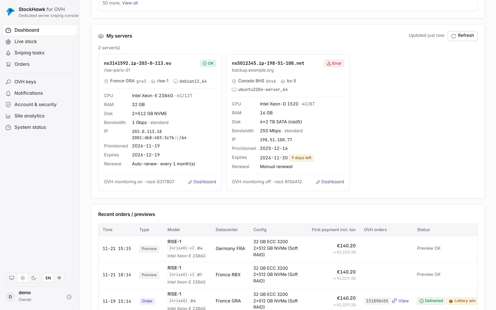
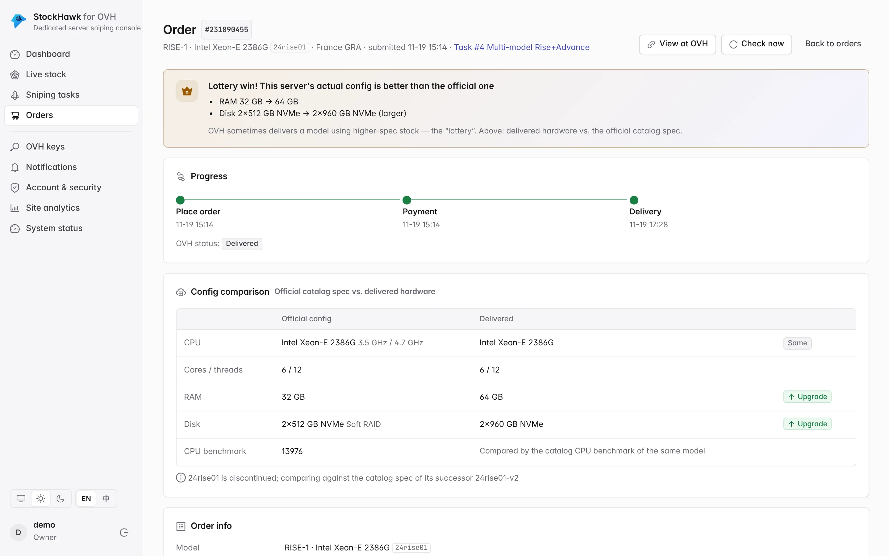
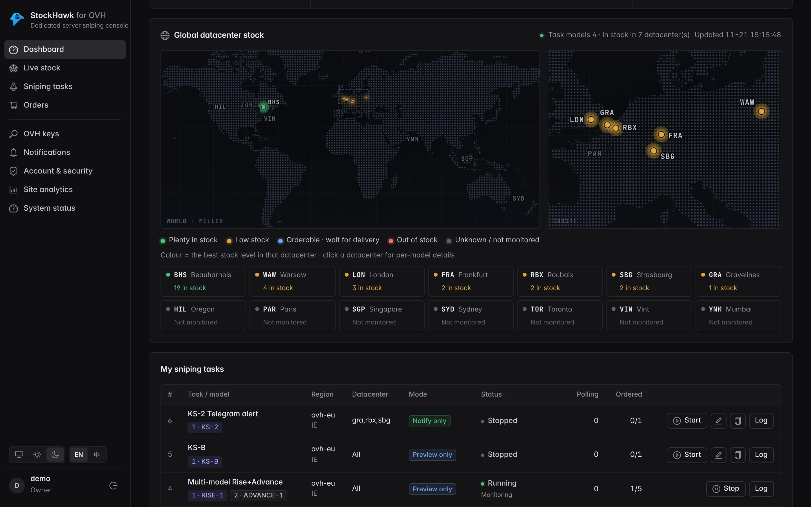
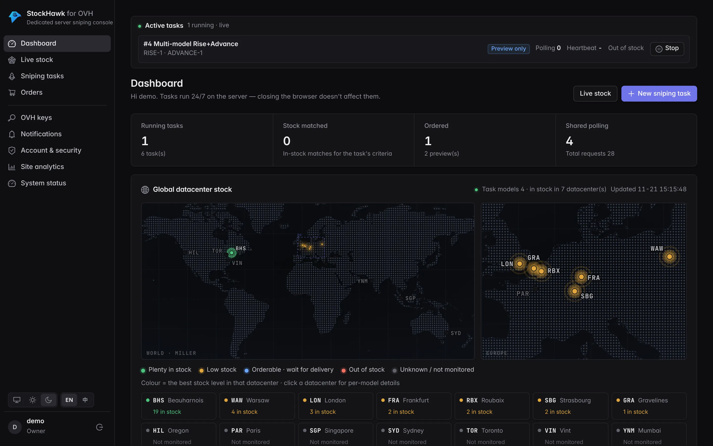
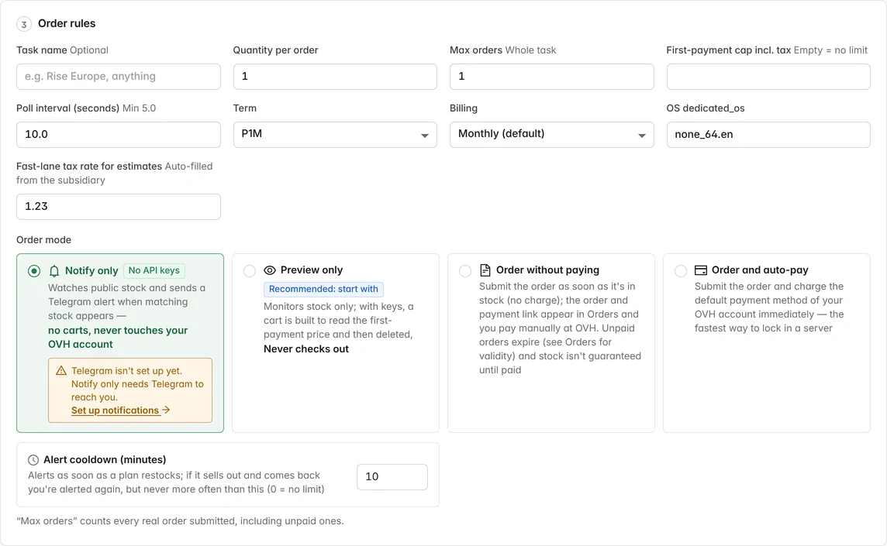
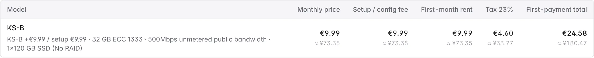

<p align="center">
  <picture>
    <source media="(prefers-color-scheme: dark)" srcset="docs/brand/stockhawk-wordmark.svg">
    
  </picture>
</p>

# StockHawk for OVH · OVH dedicated-server stock watcher & sniper panel

**English** · [简体中文](README.zh-CN.md) · Website: [www.7919.net](https://www.7919.net) · [Releases](https://github.com/super888-png/stockhawk-ovh/releases)

> **Unofficial project. Not affiliated with OVHcloud.** OVH, OVHcloud, Kimsufi and So you Start are trademarks of OVH SAS.
>
> Formerly *OVH Sniper*. The command (`ovh-sniper`), install directory (`/opt/ovh-sniper`), container and `OVH_SNIPER_*` variables keep their old names so existing installs update in place.

A self-hosted web panel that **watches OVH dedicated-server stock and orders automatically** (Kimsufi / So you Start / Eco / Rise / Advance / Scale…). You run it on your own VPS. It has a single owner account and places orders with *your own* OVH API keys.

---

## Contents
- [Features](#features)
- [Interface language](#interface-language)
- [Screenshots](#screenshots)
- [Requirements](#requirements)
- [One-line install](#one-line-install)
- [Manual install](#manual-install)
- [Updating](#updating)
- [Backup and restore](#backup-and-restore)
- [HTTPS (Caddy / Cloudflare Tunnel / Cloudflare proxy)](#https)
- [Commands](#commands)
- [FAQ](#faq)
- [Development / tests](#development--tests)
- [Installing from a fork](#installing-from-a-fork)
- [Disclaimer](#disclaimer)

## Features

- **Single owner.** There is no sign-up page. You create the account on the server from the command line (`ovh-sniper create-admin`), so nobody can register before you after you deploy.
- **Any plan.** Pick a planCode from OVH's live public catalog (ovh-eu / ovh-ca / ovh-us, with optional subsidiary IE/FR/DE/GB/CA/US…). Plans show a readable name and CPU (e.g. `KS-B · Intel Xeon E5-1620v2`), and configurations read like "32 GB ECC 1333 · 1×120 GB SSD (no RAID) · 500 Mbps".
- **Sniper tasks.** The new-task picker is the same filterable live-stock table as *Live stock*: tick rows to batch-add several machines (model + config + datacenters); the selection order is the priority (drag or ↑/↓ to reorder), and each machine keeps its own config and datacenter list (or "any"). Live stock rows deep-link into a pre-filled task. You can filter by RAM, disk and bandwidth, and set a maximum number of orders, a first-payment cap (VAT included) and the poll interval.
- **Four order modes:**
  - **Notify only:** watch public stock and send a Telegram restock card (product, CPU, RAM, storage, datacenter, availability, price, setup fee, with *Order now* buttons to the OVH express order page) when a matching configuration appears; the same message is edited to struck-through "Sold out at …" when it goes. No carts, never touches your OVH account, no API keys needed. Alerts again after the plan sells out and comes back, with a per-task cooldown. Requires Telegram to be set up.
  - **Preview only:** build a cart, read the price, delete the cart.
  - **Order without paying:** the order comes with OVH's payment link.
  - **Order and pay automatically.**

  An optional "fast lane" builds the cart ahead of time.
- **Cost estimate.** Shows monthly and 12 / 24-month prepaid prices, the setup fee, VAT and the first-payment total, each also in CNY at the live exchange rate.
- **Live log.** Pushed over SSE: new lines appear within 1–2 s and auto-scroll. It shows the poll count, how long ago each poll ran, its duration and whether stock matched. If the connection drops, it falls back to polling.
- **Running tasks.** One row at the top shows every running task (plan, mode, polls, last heartbeat), each with a stop button.
- **Shared polling.** Several tasks watching the same plan make only one request to OVH.
- **Live stock.** Filter by region, catalog or keyword, then snipe in one click.
- **Notifications.** Telegram or webhook, with per-category switches (stock, order placed, payment, delivery, task reminders) and amounts in CNY. **The notification language can be set separately.**
- **Delivery tracking.** Read-only tracking of order status after you order. Once a server is delivered, the panel reads its actual hardware and compares it with the advertised specs. **If you got better hardware than advertised, it tells you.**
- **My servers / account orders.**
  - The dashboard lists your existing servers: state, configuration, IP and expiry.
  - The orders page shows the last 90 days, summarised as "plan · datacenter · CPU / config / term".
  - Bills, debt payments and refunds get short labels; the raw details can be expanded.
- **Security.** OVH keys are stored encrypted with Fernet. The panel also has a strict CSP, CSRF plus same-origin checks, SSRF protection, login rate limiting and an audit log. See [docs/SECURITY.md](docs/SECURITY.md).
- **Global datacenter stock map.** A world map with a Europe inset shows stock for each datacenter:
  - green: plenty
  - yellow: low
  - blue: awaiting delivery
  - red: out of stock
  - grey: not watched

  Hover a datacenter for per-plan details.
- Light and dark themes (follow the system), mobile friendly.
- **Bilingual, English and 中文.** English is the default; the language switch is in the top right.

## Interface language

- The panel speaks **English and Chinese**, and **English is the default**. It never switches automatically based on the browser's `Accept-Language`.
- The **EN / 中** switch in the top right saves your choice to your account (database) and a cookie, so it follows you across devices.
- To change the default for new visitors, the CLI and the scripts, set `DEFAULT_LANG=zh` in `.env` and run `ovh-sniper restart`. At install time, `OVH_SNIPER_LANG=zh` makes the installer speak Chinese and write `DEFAULT_LANG=zh`.
- The Telegram / webhook notification language is set on the Notifications page. By default it follows the panel language.
- The management scripts (`install.sh` / `manage.sh` / `update.sh` / `uninstall.sh`) read `OVH_SNIPER_LANG`, or else `DEFAULT_LANG` from `.env`.

## Screenshots

All screenshots use demo data (`tests/site_shots.py` + `tests/run_mock_server.py`).

| Dashboard (datacenter stock map, running tasks) | Task detail · live log (SSE) |
|---|---|
|  |  |
| **My servers** | **Account orders (auto-summarised)** |
|  |  |
| **Global datacenter stock map (dark)** | **Dark theme** |
|  |  |
| **Order modes · Notify only (Telegram not set up yet)** | |
|  | |

Cost estimate:




## Requirements

- A VPS running **Debian 11/12/13 or Ubuntu 20.04+**, x86_64 or arm64, with root access.
- At least 512 MB of RAM (below 1 GB the installer adds swap automatically) and 3 GB of free disk.
- A datacenter in Europe or North America is recommended: it is closer to the OVH API, so you are faster.
- An OVH account and API keys. The panel's "OVH keys" page walks you through creating them in one click.
- Optional: a domain name, for HTTPS.

## One-line install

```bash
curl -fsSL https://www.7919.net/install.sh | sudo bash
```

If www.7919.net is unreachable from your server, use the copy on GitHub (same file):

```bash
curl -fsSL https://raw.githubusercontent.com/super888-png/stockhawk-ovh/main/install.sh | sudo bash
```

The script:
1. installs Docker if it is missing
2. creates swap if RAM is under 1 GB
3. downloads the code to `/opt/ovh-sniper`
4. writes a `.env` with a random `SECRET_KEY`
5. asks for the port (default 8000)
6. builds and starts the panel
7. creates the owner account interactively
8. prints the URL

It is safe to re-run: your existing `.env`, data and account are kept.

Unattended install (e.g. from cloud-init):

```bash
curl -fsSL https://raw.githubusercontent.com/super888-png/stockhawk-ovh/main/install.sh -o install.sh
sudo OVH_SNIPER_NONINTERACTIVE=1 OVH_SNIPER_PORT=8000 \
     OVH_SNIPER_ADMIN_USER=admin OVH_SNIPER_ADMIN_PASSWORD='use-a-strong-password' bash install.sh
```

Other variables:

| Variable | Purpose |
|---|---|
| `OVH_SNIPER_LANG` | `en` / `zh`: installer language and default UI language |
| `OVH_SNIPER_DIR` | Install directory |
| `OVH_SNIPER_BIND` | Bind address; use `127.0.0.1` behind a reverse proxy |
| `OVH_SNIPER_REPO` / `OVH_SNIPER_BRANCH` | Repository and branch to install from |
| `OVH_SNIPER_SKIP_SWAP=1` | Skip creating swap |

## Manual install

```bash
# 1. Install Docker
curl -fsSL https://get.docker.com | sh

# 2. Get the code
git clone https://github.com/super888-png/stockhawk-ovh.git /opt/ovh-sniper
cd /opt/ovh-sniper

# 3. Configure
cp .env.example .env
sed -i "s|^SECRET_KEY=.*|SECRET_KEY=$(head -c 48 /dev/urandom | base64 | tr -d '\n/+=')|" .env
chmod 600 .env
nano .env        # adjust PORT / BIND_ADDR / COOKIE_SECURE / DEFAULT_LANG if needed

# 4. Start
docker compose up -d --build

# 5. Create the owner account (prompts for username and password)
docker compose exec ovh-sniper python -m app.cli create-admin

# 6. Optional: install the management command
ln -sf /opt/ovh-sniper/manage.sh /usr/local/bin/ovh-sniper
```

Open `http://SERVER_IP:8000`, log in, then enter your API keys on the "OVH keys" page.

> You can also run it without Docker:
> 1. `python3 -m venv .venv && .venv/bin/pip install -r requirements.txt`
> 2. `./run.sh` (reads `.env` and listens on 127.0.0.1 by default)
> 3. Create the account with `.venv/bin/python -m app.cli create-admin`

## Updating

```bash
ovh-sniper update          # same as sudo /opt/ovh-sniper/update.sh
```

The update backs up first, runs `git pull`, rebuilds the image and then runs a health check. `.env` and `data/` are never touched.

To customise compose (extra networks, logging…), put the changes in `docker-compose.override.yml` (git-ignored). Don't edit `docker-compose.yml`, or `git pull` will conflict.

## Backup and restore

All state lives in the install directory: `.env` (which contains `SECRET_KEY`) and `data/app.db`. **Always back up both together.** Without the matching `SECRET_KEY`, saved OVH keys cannot be decrypted.

```bash
ovh-sniper backup                                   # online backup to /opt/ovh-sniper/backups/ (keeps the last 10)
ovh-sniper restore backups/ovh-sniper-20260101-120000.tgz
```

To move to a new server, run the one-line install there, then `ovh-sniper restore <backup file>`. The restore brings `.env` back too.

Daily backup at 04:00:

```bash
echo '0 4 * * * root /usr/local/bin/ovh-sniper backup >/dev/null 2>&1' | sudo tee /etc/cron.d/ovh-sniper-backup
```

Backups contain `SECRET_KEY`; treat them like a password.

## HTTPS

By default the panel is served over plain HTTP, so your login password and session cookie could be sniffed. **Set up HTTPS before real use.** Pick one of the options below.

### Option 1: Caddy (with a domain, automatic certificates)

```bash
# 1. Point the domain's A record at the server; open ports 80/443
sudo apt install -y caddy
# 2. Make the app listen on localhost only
sudo sed -i 's/^BIND_ADDR=.*/BIND_ADDR=127.0.0.1/; s/^COOKIE_SECURE=.*/COOKIE_SECURE=1/' /opt/ovh-sniper/.env
# 3. Configure Caddy
sudo tee /etc/caddy/Caddyfile >/dev/null <<'CADDY'
sniper.example.com {
    reverse_proxy 127.0.0.1:8000
}
CADDY
sudo systemctl reload caddy
ovh-sniper restart
```

If port 443 is taken by another program, Caddy can listen on another port instead (e.g. `sniper.example.com:8443`, with a certificate from DNS validation).

### Option 2: Cloudflare Tunnel (no open ports, no public IP needed)

```bash
# Create a tunnel in Cloudflare Zero Trust → Networks → Tunnels, then install cloudflared and run the token command it shows
# Point the public hostname at http://127.0.0.1:8000
sudo sed -i 's/^BIND_ADDR=.*/BIND_ADDR=127.0.0.1/; s/^COOKIE_SECURE=.*/COOKIE_SECURE=1/' /opt/ovh-sniper/.env
ovh-sniper restart
```

For a quick test, `cloudflared tunnel --url http://127.0.0.1:8000` gives you a random trycloudflare.com hostname.

### Option 3: Cloudflare proxy (orange cloud, works even when port 443 is busy)

Useful when another program (e.g. xray/REALITY) owns port 443 on the server.

1. Cloudflare DNS: `A sniper → <server IP>`, **Proxied** (orange cloud).
2. Rules → Origin Rules: *Hostname equals `sniper.example.com`* → **Destination port `8000`**.
3. SSL/TLS: **Flexible** for this hostname (Cloudflare talks plain HTTP to the origin; zone-wide or via a Configuration Rule). Turn on *Always Use HTTPS*.
4. In `.env`:

```bash
TRUST_CLOUDFLARE=1      # trust CF-Connecting-IP / X-Forwarded-Proto / CF-Visitor, but only from Cloudflare's IP ranges
# COOKIE_SECURE=0       # keep 0 while you still log in via http://IP:8000; https requests get Secure cookies anyway
```

then `ovh-sniper restart`. With `TRUST_CLOUDFLARE=1` the panel treats requests from Cloudflare edges as HTTPS (Secure session cookie, same-origin check against `https://sniper.example.com`) and uses the visitor's real IP for the login rate limit and the audit log. Requests that do not come from Cloudflare's published ranges (`CF_IPS` overrides the built-in list) keep their own IP and scheme, so spoofed headers are ignored. Once everything works, consider closing direct access to port 8000 for non-Cloudflare IPs in your firewall and setting `COOKIE_SECURE=1`. With Flexible the hop Cloudflare → server is unencrypted; for end-to-end TLS use Option 1 on a free port with a Cloudflare Origin Certificate and SSL mode *Full (strict)*.

After setting up HTTPS:
- set `COOKIE_SECURE=1`
- make the app listen on `127.0.0.1` only
- if the reverse proxy runs outside Docker, set `FORWARDED_ALLOW_IPS=172.16.0.0/12` in `.env` so the login rate limit sees real client IPs

## Commands

| Command | What it does |
|---|---|
| `ovh-sniper status` | Container status and accounts |
| `ovh-sniper logs` | Follow the logs |
| `ovh-sniper restart` | Restart (needed after editing `.env`) |
| `ovh-sniper update` | Update |
| `ovh-sniper backup` / `restore <file>` | Back up / restore |
| `ovh-sniper reset-password` | Reset a forgotten password (signs out every device) |
| `ovh-sniper uninstall` | Uninstall (optionally keeping data) |

## FAQ

**I forgot my password.**
SSH into the server and run `ovh-sniper reset-password`.

**Can I give a friend an account?**
No. The panel is designed as one instance per person: everyone deploys it on their own VPS with their own OVH keys. That way nobody hands their keys to someone else, and shared use can't trigger OVH's rate limits.

**Will it really place orders and charge me?**
- Only "Order and pay automatically" charges your OVH account's default payment method.
- "Notify only" never touches your OVH account at all; it only sends Telegram alerts.
- New tasks default to "Preview only".
- Before a real order, the panel checks the first-payment cap.
- If a checkout result is uncertain, the task stops and asks you to check by hand. It never orders twice.

**Why is it always out of stock?**
Popular plans (especially KS and Black Friday limited editions) usually sell out within seconds. To improve your odds:
- shorten the poll interval (not below `MIN_POLL_INTERVAL`)
- select more datacenters
- enable the "fast lane"
- host the panel close to OVH

**"My servers" shows 403.**
OVH tokens created before v1.3 lack the `GET /dedicated/server` permission. Click "Re-authorise with existing app" in the notice. Ordering is not affected.

**The live log doesn't move.**
- The status line at the top shows "Polls: N · X s ago".
- Behind Nginx, turn off buffering for `/api/tasks/*/stream` (`proxy_buffering off;`). Caddy and Cloudflare Tunnel need nothing extra.
- If the stream can't connect, the page falls back to polling every 1.5 s.

**Is 512 MB of RAM enough?**
Yes. It uses about 50–150 MB at runtime (about 50 MB measured on a 512 MB VPS). Building the image needs swap, which the installer creates automatically.

**How do I change the port?**
Edit `PORT` in `/opt/ovh-sniper/.env`, then run `ovh-sniper restart`.

**How do I switch the default language to Chinese?**
Set `DEFAULT_LANG=zh` in `.env` and run `ovh-sniper restart`. Each user can still switch with the EN / 中 button.

**What's in the install directory?**
- `.env`: configuration and secrets, mode 600
- `data/`: the SQLite database and catalog cache
- `backups/`

Everything else is code that you can update with `git pull` at any time.

## Development / tests

```bash
python3 -m venv .venv && .venv/bin/pip install -r requirements.txt playwright
export SECRET_KEY=$(python3 -c "import secrets;print(secrets.token_urlsafe(48))")
.venv/bin/python tests/run_mock_server.py 8810 ok        # mock OVH account + demo data (random password in /tmp/ovh-sniper-mock-cred.json)
.venv/bin/python tests/selfcheck_flow.py                 # end to end: task → stock → cart → preview → 3 order modes → tracking → notifications → orders
.venv/bin/python tests/mock_order_test.py                # mocked OVH ordering flow (stock from the real public API)
.venv/bin/python tests/v14_test.py                       # notifications / SSRF / prices / tracking / security
.venv/bin/python tests/mock_account_test.py              # account servers and order parsing
.venv/bin/python tests/options_match_test.py             # option matching (real KS-LE-3 catalog data)
.venv/bin/python tests/v16_test.py                       # datacenter map API
.venv/bin/python tests/i18n_unit_test.py                 # bilingual: English default, notification language, CLI
.venv/bin/python tests/notify_only_test.py               # notify-only: Telegram check, alert de-dup + cooldown, texts
DEFAULT_LANG=en .venv/bin/python tests/run_mock_server.py 8830 ok &
.venv/bin/python tests/i18n_test.py                      # browser: no Chinese left in English pages, switching, per-user persistence
.venv/bin/python tools_i18n_extract.py                   # checks the English catalog is complete
DEFAULT_LANG=zh .venv/bin/python tests/ui_v15.py         # legacy browser checks (Chrome + playwright; they assert Chinese copy)
DEFAULT_LANG=zh .venv/bin/python tests/ui_v16.py         # datacenter map browser check + screenshots
```

## Installing from a fork

The installer clones `https://github.com/super888-png/stockhawk-ovh.git` by default. To install your own fork or branch instead:

```bash
curl -fsSL https://raw.githubusercontent.com/<your-account>/stockhawk-ovh/main/install.sh -o install.sh
sudo OVH_SNIPER_REPO=https://github.com/<your-account>/stockhawk-ovh.git OVH_SNIPER_BRANCH=main bash install.sh
```

## Disclaimer

- StockHawk for OVH is an unofficial project and is not affiliated with OVHcloud. OVH, Kimsufi and So you Start are trademarks of OVH SAS.
- The software is provided "as is" under the MIT licence. It does not guarantee you will get a server, and it is not responsible for any order, charge, account restriction or other loss. Before using automatic ordering, make sure you understand OVH's terms of service. You use it at your own risk.
- Keep poll intervals reasonable; don't abuse the OVH API.
- Your OVH API keys are stored only on your own server, encrypted, and are never uploaded to any third party.

## License

Third-party assets:
- Icons are from Ant Design Icons (MIT; see `app/static/ICONS-LICENSE.txt`).
- The base map is from [Natural Earth](https://www.naturalearthdata.com/) (public domain). `tools/gen_worldmap.py` generates `app/static/worldmap.svg` from it offline.

[MIT](LICENSE)
