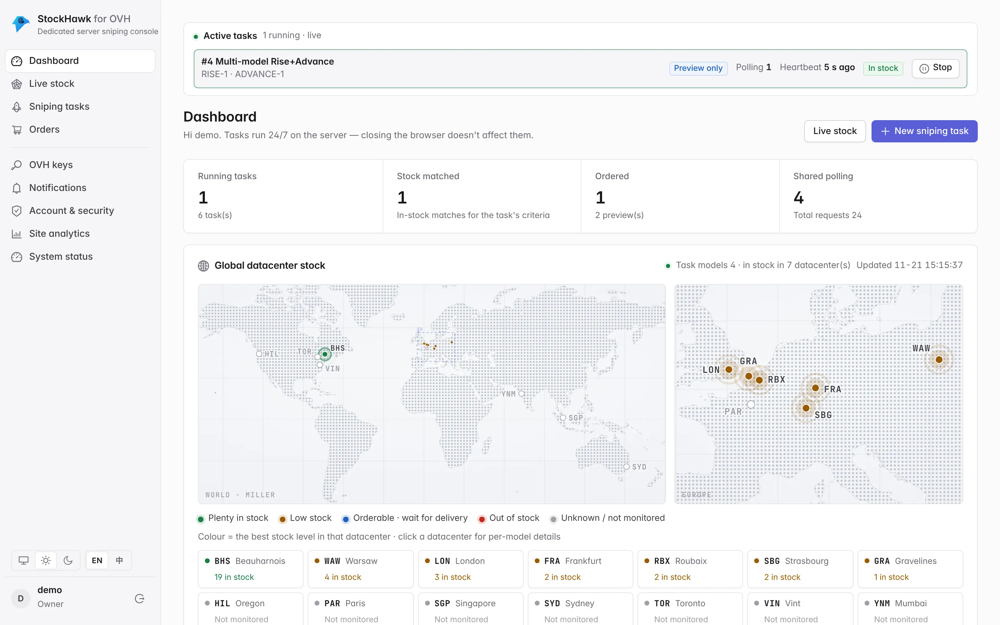
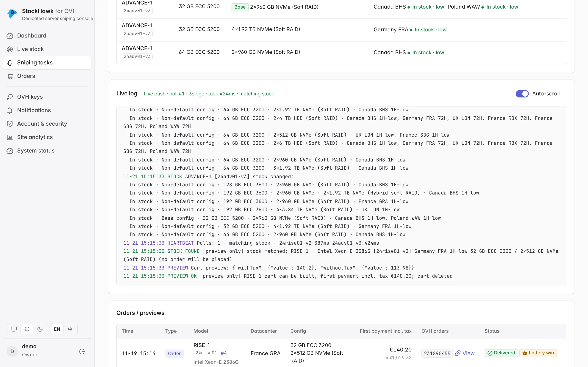
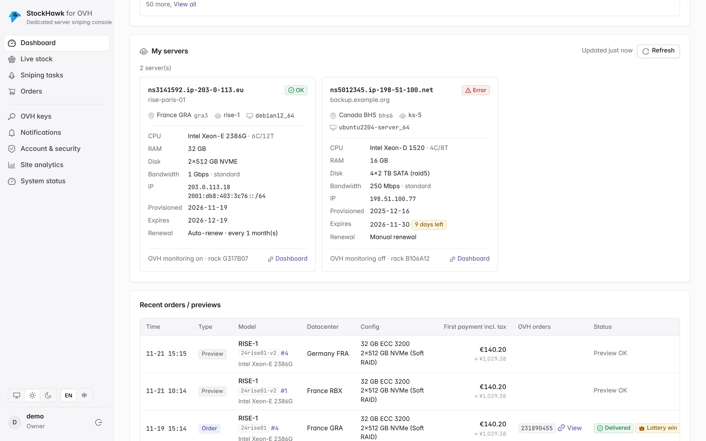
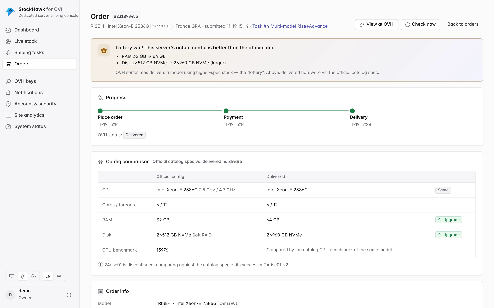
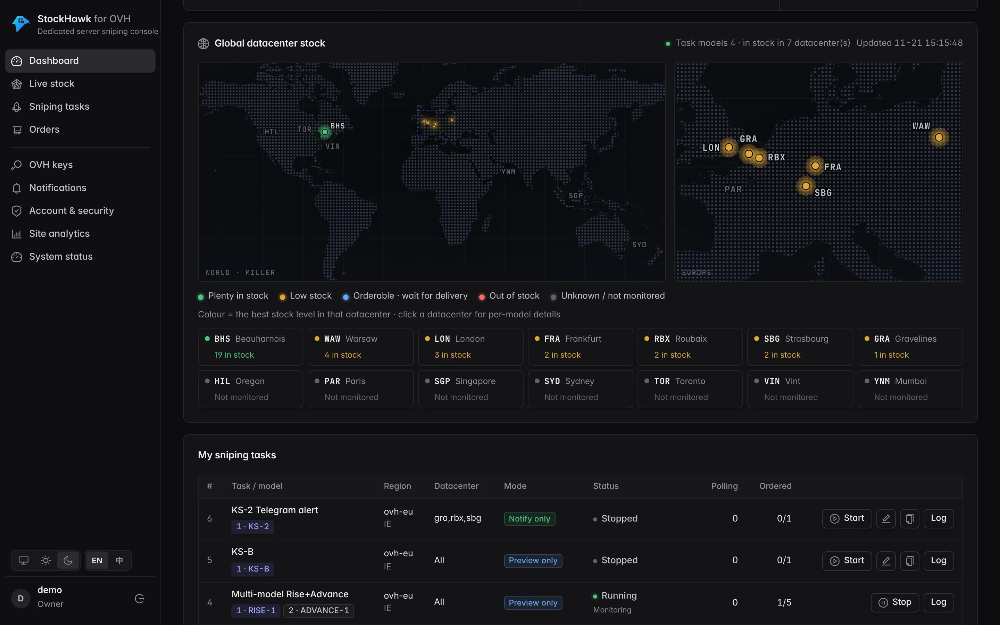
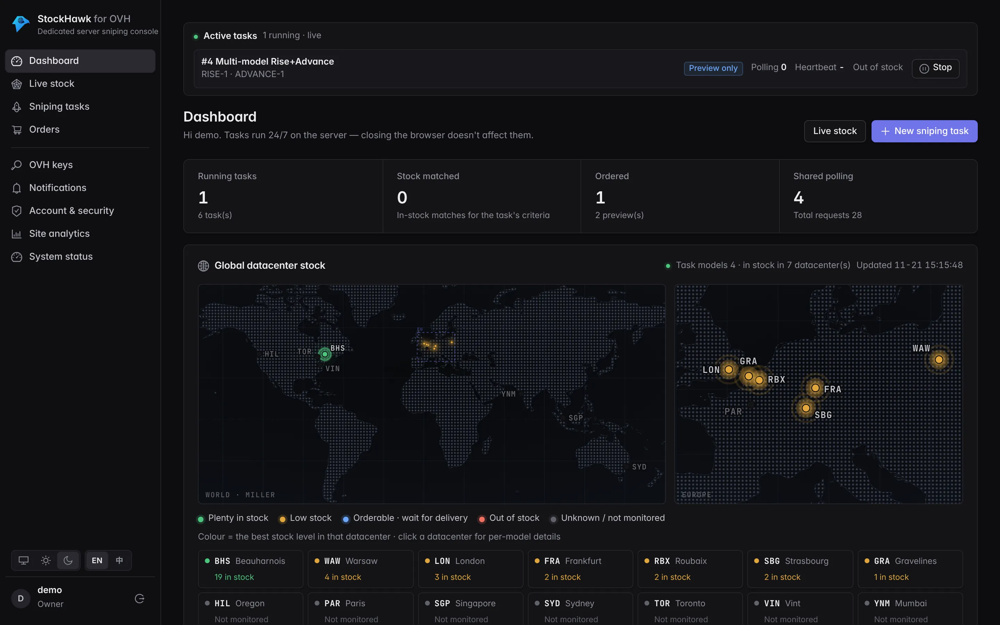
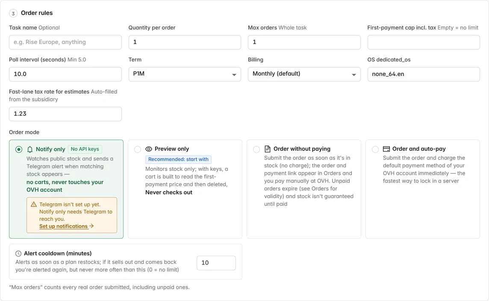
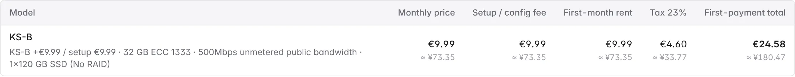

<p align="center">
  <picture>
    <source media="(prefers-color-scheme: dark)" srcset="docs/brand/stockhawk-wordmark.svg">
    
  </picture>
</p>

# StockHawk for OVH · OVH 独服库存监控与抢购面板

[English](README.md) · **简体中文** · 官网：[www.7919.net](https://www.7919.net) · [版本发布](https://github.com/super888-png/stockhawk-ovh/releases)

> **非 OVHcloud 官方项目，与 OVH 无关联。** OVH、OVHcloud、Kimsufi、So you Start 是 OVH SAS 的商标。
>
> 原名 *OVH Sniper*。为了让旧安装原地升级，命令 `ovh-sniper`、安装目录 `/opt/ovh-sniper`、容器名和 `OVH_SNIPER_*` 变量保持不变。

自托管的 OVH 独立服务器（Kimsufi / So you Start / Eco / Rise / Advance / Scale…）**库存监控 + 自动下单**网页面板。部署在你自己的 VPS 上，只有你一个账号，用你自己的 OVH API 密钥下单。

---

## 目录
- [功能](#功能)
- [界面语言](#界面语言)
- [截图](#截图)
- [环境要求](#环境要求)
- [一键安装](#一键安装)
- [手动安装](#手动安装)
- [更新](#更新)
- [备份与恢复](#备份与恢复)
- [HTTPS（Caddy / Cloudflare Tunnel / Cloudflare 代理）](#https)
- [常用命令](#常用命令)
- [常见问题](#常见问题)
- [从 Fork 安装](#从-fork-安装)
- [免责声明](#免责声明)

## 功能

- **单一所有者**：没有注册页面。账号在服务器上用命令行创建（`ovh-sniper create-admin`），不会出现「部署后被别人抢先注册」的问题
- **任意型号**：从 OVH 实时公开目录选择 planCode（ovh-eu / ovh-ca / ovh-us，可选子公司 IE/FR/DE/GB/CA/US…），显示通用型号名和 CPU（例如 `KS-B · Intel Xeon E5-1620v2`），配置显示为「32 GB ECC 1333 · 1×120 GB SSD（无 RAID）· 500 Mbps」
- **抢购任务**：一个任务可盯多个型号（按优先级），机房多选（按勾选顺序优先），内存 / 硬盘 / 带宽，最多下单数、首期含税上限、轮询间隔
- **四种下单方式**：仅提醒（只监控公开库存，有货发 Telegram 提醒，不建购物车、不碰 OVH 账号，无需密钥；售罄后再补货会再次提醒，可设冷却时间；需要先配置 Telegram）/ 只预览（建购物车读价格后删除，不下单）/ 只下单不付款（订单附 OVH 付款链接）/ 下单并自动付款；可选「快速通道」预建购物车
- **费用预估**：月付 / 12 / 24 个月预付，安装费、增值税、首期合计，全部附人民币（实时汇率）
- **实时日志**：SSE 推送，新日志 1–2 秒内出现，自动滚动；显示第几次轮询、多久之前、耗时、是否有匹配库存；断线自动改为轮询
- **进行中的任务**：任务页顶部一行显示所有运行中的任务（型号、模式、轮询次数、最后心跳），可一键停止
- **共享轮询**：同一型号的多个任务只向 OVH 请求一次
- **实时库存**：按区域 / 目录 / 关键字筛选，一键「抢」
- **通知**：Telegram / Webhook，分类开关（有货 / 提交订单 / 付款 / 交付 / 任务提醒），附金额和人民币
- **交付跟踪**：下单后只读跟踪订单状态；交付后读取服务器实际硬件，与官网规格对比，**抽到更高配置时提示「中奖」**
- **我的服务器 / 账号订单**：控制台显示账号已有的服务器（状态、配置、IP、到期时间）；订单记录显示近 90 天订单，自动整理成「型号 · 机房 · CPU / 配置 / 周期」，账单、欠款支付、退款显示为简短标签，原始明细可展开
- **安全**：OVH 密钥 Fernet 加密存储、严格 CSP、CSRF + 同源校验、SSRF 防护、登录限速、审计日志，详见 [docs/SECURITY.md](docs/SECURITY.md)
- **全球机房库存地图**：控制台用世界地图 + 欧洲放大图显示各机房库存（绿 充足 / 黄 少量 / 蓝 等交付 / 红 无货 / 灰 未监控），悬停看各型号详情
- 浅色 / 深色主题（跟随系统），移动端可用
- **中英双语**：默认英文，右上角一键切换 EN / 中，按用户保存；Telegram 通知可单独设语言

## 截图

截图全部使用演示数据生成（`tests/site_shots.py` + `tests/run_mock_server.py`），界面为英文（默认语言），右上角可切换中文。

| 控制台（机房库存地图、进行中的任务） | 任务详情 · 实时日志（SSE） |
|---|---|
|  |  |
| **我的服务器** | **账号订单（自动整理）** |
|  |  |
| **全球机房库存地图（深色）** | **深色主题** |
|  |  |
| **下单方式 · 仅提醒（尚未配置 Telegram）** | |
|  | |

费用预估：



## 界面语言

- 面板支持 **English / 中文**，**默认英文**。不会根据浏览器 `Accept-Language` 自动切换。
- 右上角的 **EN / 中** 按钮切换语言，保存在当前账号（数据库）和 Cookie 里，换设备登录也会保持。
- 修改新访客、命令行和脚本的默认语言：在 `.env` 里设置 `DEFAULT_LANG=zh`，然后 `ovh-sniper restart`。安装时可用 `OVH_SNIPER_LANG=zh` 让安装脚本输出中文并写入 `DEFAULT_LANG=zh`。
- Telegram / Webhook 通知语言在「通知」页单独设置（默认跟随面板语言）。
- 管理脚本（`install.sh` / `manage.sh` / `update.sh` / `uninstall.sh`）读取 `OVH_SNIPER_LANG` 或 `.env` 里的 `DEFAULT_LANG`。


## 环境要求

- 一台 VPS：**Debian 11/12/13 或 Ubuntu 20.04+**，x86_64 或 arm64，root 权限
- 内存 512 MB 起（小于 1 GB 时安装脚本会自动加 swap）；磁盘 3 GB 以上空闲
- 建议选欧洲 / 北美机房（离 OVH API 近，抢购更快）
- OVH 账号和 API 密钥（在面板的「OVH 密钥」页按引导一键创建）
- 可选：一个域名（用于 HTTPS）

## 一键安装

```bash
curl -fsSL https://www.7919.net/install.sh | sudo bash
```

如果服务器访问不了 www.7919.net，用 GitHub 上的同一份脚本：

```bash
curl -fsSL https://raw.githubusercontent.com/super888-png/stockhawk-ovh/main/install.sh | sudo bash
```

脚本会：安装 Docker（如未安装）→ 内存不足 1 GB 时创建 swap → 下载代码到 `/opt/ovh-sniper` → 生成带随机 `SECRET_KEY` 的 `.env` → 询问端口（默认 8000）→ 构建并启动 → 交互式创建所有者账号 → 打印访问地址。

可以重复运行：已有的 `.env`、数据和账号都会保留。

无人值守安装（例如写进 cloud-init）：

```bash
curl -fsSL https://raw.githubusercontent.com/super888-png/stockhawk-ovh/main/install.sh -o install.sh
sudo OVH_SNIPER_NONINTERACTIVE=1 OVH_SNIPER_PORT=8000 \
     OVH_SNIPER_ADMIN_USER=admin OVH_SNIPER_ADMIN_PASSWORD='换成你的强密码' bash install.sh
```

其他变量：`OVH_SNIPER_LANG`（`en` / `zh`，安装脚本语言和默认界面语言）、`OVH_SNIPER_DIR`（安装目录）、`OVH_SNIPER_BIND`（监听地址，反代时设为 `127.0.0.1`）、`OVH_SNIPER_REPO` / `OVH_SNIPER_BRANCH`、`OVH_SNIPER_SKIP_SWAP=1`。

## 手动安装

```bash
# 1. 安装 Docker
curl -fsSL https://get.docker.com | sh

# 2. 下载代码
git clone https://github.com/super888-png/stockhawk-ovh.git /opt/ovh-sniper
cd /opt/ovh-sniper

# 3. 配置
cp .env.example .env
sed -i "s|^SECRET_KEY=.*|SECRET_KEY=$(head -c 48 /dev/urandom | base64 | tr -d '\n/+=')|" .env
chmod 600 .env
nano .env        # 按需修改 PORT / BIND_ADDR / COOKIE_SECURE / DEFAULT_LANG

# 4. 启动
docker compose up -d --build

# 5. 创建所有者账号（会提示输入用户名和密码）
docker compose exec ovh-sniper python -m app.cli create-admin

# 6. 可选：安装管理命令
ln -sf /opt/ovh-sniper/manage.sh /usr/local/bin/ovh-sniper
```

浏览器打开 `http://服务器IP:8000` 登录，然后到「OVH 密钥」页填写 API 密钥。

> 不用 Docker 也能运行：`python3 -m venv .venv && .venv/bin/pip install -r requirements.txt`，然后 `./run.sh`（读取 `.env`，默认只监听 127.0.0.1）。账号同样用 `.venv/bin/python -m app.cli create-admin` 创建。

## 更新

```bash
ovh-sniper update          # 等同于 sudo /opt/ovh-sniper/update.sh
```

先自动备份，再 `git pull` 并重建镜像，最后做健康检查。`.env` 和 `data/` 不会被改动。

需要自定义 compose（例如加网络、改日志）时，请写在 `docker-compose.override.yml`（已被 git 忽略），不要直接改 `docker-compose.yml`，否则 `git pull` 会冲突。

## 备份与恢复

所有数据都在安装目录：`.env`（含 `SECRET_KEY`）和 `data/app.db`。**两者必须一起备份**，`SECRET_KEY` 不对就无法解密已保存的 OVH 密钥。

```bash
ovh-sniper backup                                   # 在线备份到 /opt/ovh-sniper/backups/（保留最近 10 份）
ovh-sniper restore backups/ovh-sniper-20260101-120000.tgz
```

迁移到新服务器：在新服务器上运行一键安装 → `ovh-sniper restore 备份文件`（会同时恢复 `.env`）。

定时备份（每天 4 点）：

```bash
echo '0 4 * * * root /usr/local/bin/ovh-sniper backup >/dev/null 2>&1' | sudo tee /etc/cron.d/ovh-sniper-backup
```

备份文件含 `SECRET_KEY`，请像密码一样保管。

## HTTPS

默认是 HTTP 明文访问，登录密码和会话 Cookie 可能被窃听。**正式使用前建议配置 HTTPS**，任选一种：

### 方式一：Caddy（有域名，自动申请证书）

```bash
# 1. 域名 A 记录指向服务器 IP；放行 80/443 端口
sudo apt install -y caddy
# 2. 让应用只监听本机
sudo sed -i 's/^BIND_ADDR=.*/BIND_ADDR=127.0.0.1/; s/^COOKIE_SECURE=.*/COOKIE_SECURE=1/' /opt/ovh-sniper/.env
# 3. 配置 Caddy
sudo tee /etc/caddy/Caddyfile >/dev/null <<'CADDY'
sniper.example.com {
    reverse_proxy 127.0.0.1:8000
}
CADDY
sudo systemctl reload caddy
ovh-sniper restart
```

443 被其他程序占用时，可以让 Caddy 监听其他端口（如 `sniper.example.com:8443`，证书用 DNS 验证）。

### 方式二：Cloudflare Tunnel（不开放端口，无需公网 IP）

```bash
# 在 Cloudflare Zero Trust → Networks → Tunnels 创建隧道，按页面提示安装 cloudflared 并运行 token 命令
# 公共主机名指向 http://127.0.0.1:8000
sudo sed -i 's/^BIND_ADDR=.*/BIND_ADDR=127.0.0.1/; s/^COOKIE_SECURE=.*/COOKIE_SECURE=1/' /opt/ovh-sniper/.env
ovh-sniper restart
```

临时测试可用 `cloudflared tunnel --url http://127.0.0.1:8000`（随机 trycloudflare.com 域名）。

### 方式三：Cloudflare 代理（橙色云朵，443 被占用时也能用）

适合服务器 443 端口已被其他程序（例如 xray/REALITY）占用的情况。

1. Cloudflare DNS：`A sniper → <服务器 IP>`，**已代理**（橙色云朵）。
2. Rules → Origin Rules：*主机名等于 `sniper.example.com`* → **目标端口 `8000`**。
3. SSL/TLS：对该主机名使用 **Flexible（灵活）**（Cloudflare 以明文 HTTP 回源；可全区设置或用配置规则单独设置），并开启 *始终使用 HTTPS*。
4. 在 `.env` 中：

```bash
TRUST_CLOUDFLARE=1      # 信任 CF-Connecting-IP / X-Forwarded-Proto / CF-Visitor，但只信任来自 Cloudflare IP 段的请求
# COOKIE_SECURE=0       # 仍需通过 http://IP:8000 登录时保持 0；经 https 访问时 Cookie 会自动加 Secure
```

然后 `ovh-sniper restart`。开启 `TRUST_CLOUDFLARE=1` 后，来自 Cloudflare 节点的请求被视为 HTTPS（会话 Cookie 带 Secure，同源校验按 `https://sniper.example.com`），登录限流和审计日志使用访客真实 IP。不是来自 Cloudflare 公布 IP 段的请求（可用 `CF_IPS` 覆盖内置列表）保持原有 IP 和协议，伪造的请求头会被忽略。一切正常后，建议在防火墙中禁止非 Cloudflare IP 直连 8000 端口，并设置 `COOKIE_SECURE=1`。Flexible 模式下 Cloudflare 到服务器这一段不加密；如需端到端加密，请在空闲端口上用方式一配合 Cloudflare 源服务器证书，并使用 *Full (strict)* 模式。

配置 HTTPS 后：`COOKIE_SECURE=1`；应用只监听 `127.0.0.1`；反代在 Docker 外时把 `.env` 里的 `FORWARDED_ALLOW_IPS` 设为 `172.16.0.0/12`，登录限速才能看到真实 IP。

## 常用命令

| 命令 | 作用 |
|---|---|
| `ovh-sniper status` | 容器状态和账号 |
| `ovh-sniper logs` | 实时日志 |
| `ovh-sniper restart` | 重启（修改 `.env` 后需要） |
| `ovh-sniper update` | 更新 |
| `ovh-sniper backup` / `restore <文件>` | 备份 / 恢复 |
| `ovh-sniper reset-password` | 忘记密码时重置（所有设备会被踢下线） |
| `ovh-sniper uninstall` | 卸载（可选保留数据） |

## 常见问题

**忘记密码怎么办？** SSH 登录服务器运行 `ovh-sniper reset-password`。

**能给朋友开账号吗？** 不能，本项目设计为一人一实例：每个人在自己的 VPS 上部署，用自己的 OVH 密钥。这样密钥不会交给别人，也不会因为多人共用而触发 OVH 的频率限制。

**真的会下单扣款吗？** 只有选择「下单并自动付款」才会用 OVH 账号的默认支付方式扣款；「仅提醒」完全不碰 OVH 账号，只发 Telegram 提醒。新建任务默认是「只预览」。真实下单前会检查「首期含税上限」，结账结果不确定时任务会停止并提示人工核对，不会重复下单。

**为什么一直无货？** 热门型号（特别是 KS / 黑五限量款）通常几秒内售罄。可以缩短轮询间隔（不低于 `MIN_POLL_INTERVAL`）、多选机房、开启「快速通道」，并把服务器放在离 OVH 近的机房。

**「我的服务器」提示 403？** v1.3 之前创建的 OVH 令牌没有 `GET /dedicated/server` 权限，在提示框里点「用现有应用重新授权」即可，下单功能不受影响。

**实时日志不动？** 页面顶部的状态行会显示「第 N 次轮询 · X 秒前」。如果用了 Nginx 反代，请关闭对 `/api/tasks/*/stream` 的缓冲（`proxy_buffering off;`）；Caddy 和 Cloudflare Tunnel 无需额外配置。连不上推送时页面会自动改为每 1.5 秒轮询。

**内存只有 512 MB 够吗？** 够。运行时约 50–150 MB（实测 512 MB 的 VPS 上约 50 MB）；构建镜像时需要 swap，安装脚本会自动创建。

**怎么改端口？** 修改 `/opt/ovh-sniper/.env` 里的 `PORT`，然后 `ovh-sniper restart`。

**安装目录里有什么？** `.env`（配置和密钥，权限 600）、`data/`（SQLite 数据库和目录缓存）、`backups/`。其余都是代码，可以随时 `git pull` 更新。

## 开发 / 测试

```bash
python3 -m venv .venv && .venv/bin/pip install -r requirements.txt playwright
export SECRET_KEY=$(python3 -c "import secrets;print(secrets.token_urlsafe(48))")
.venv/bin/python tests/run_mock_server.py 8810 ok        # 模拟 OVH 账号 + 演示数据（随机密码写入 /tmp/ovh-sniper-mock-cred.json）
.venv/bin/python tests/selfcheck_flow.py                 # 端到端：建任务 → 有货 → 购物车 → 预览 → 三种下单方式 → 跟踪 → 通知 → 订单记录
.venv/bin/python tests/mock_order_test.py                # 模拟 OVH 下单全流程（库存来自真实公开 API）
.venv/bin/python tests/v14_test.py                       # 通知 / SSRF / 价格 / 跟踪 / 安全
.venv/bin/python tests/mock_account_test.py              # 账号服务器与订单解析
.venv/bin/python tests/options_match_test.py             # 配件匹配（KS-LE-3 真实目录数据）
.venv/bin/python tests/v16_test.py                       # 机房地图接口
DEFAULT_LANG=zh .venv/bin/python tests/ui_v15.py         # 浏览器检查（需要 Chrome + playwright；旧的 UI 测试检查中文文案，需 DEFAULT_LANG=zh）
DEFAULT_LANG=zh .venv/bin/python tests/ui_v16.py         # 机房地图浏览器检查 + 截图
.venv/bin/python tests/i18n_unit_test.py                 # 双语：默认英文、通知语言、命令行
.venv/bin/python tests/notify_only_test.py               # 仅提醒：Telegram 检查、提醒去重和冷却、文案
DEFAULT_LANG=en .venv/bin/python tests/run_mock_server.py 8830 ok &
.venv/bin/python tests/i18n_test.py                      # 双语浏览器检查：英文页面无中文残留、切换并按用户保存
.venv/bin/python tools_i18n_extract.py                   # 检查英文词条是否齐全
```

## 从 Fork 安装

安装脚本默认克隆 `https://github.com/super888-png/stockhawk-ovh.git`。要安装你自己的 Fork 或分支：

```bash
curl -fsSL https://raw.githubusercontent.com/<你的账号>/stockhawk-ovh/main/install.sh -o install.sh
sudo OVH_SNIPER_REPO=https://github.com/<你的账号>/stockhawk-ovh.git OVH_SNIPER_BRANCH=main bash install.sh
```

## 免责声明

- 本项目与 OVHcloud 没有任何关联。OVH、Kimsufi、So you Start 是 OVH SAS 的商标。
- 本软件按「原样」提供（MIT 许可证），不保证能抢到服务器，也不对任何下单、扣款、账号限制或其他损失负责。使用自动下单前请确认你了解 OVH 的服务条款，并自行承担风险。
- 请合理设置轮询间隔，不要滥用 OVH API。
- OVH API 密钥只保存在你自己的服务器上（加密存储），本项目不会上传到任何第三方。

## 许可证

第三方素材：图标来自 Ant Design Icons（MIT，见 `app/static/ICONS-LICENSE.txt`）；地图底图来自 [Natural Earth](https://www.naturalearthdata.com/)（公共领域），由 `tools/gen_worldmap.py` 离线生成 `app/static/worldmap.svg`。

[MIT](LICENSE)
